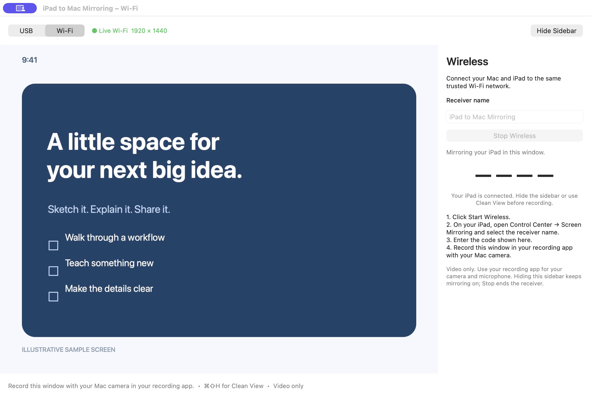
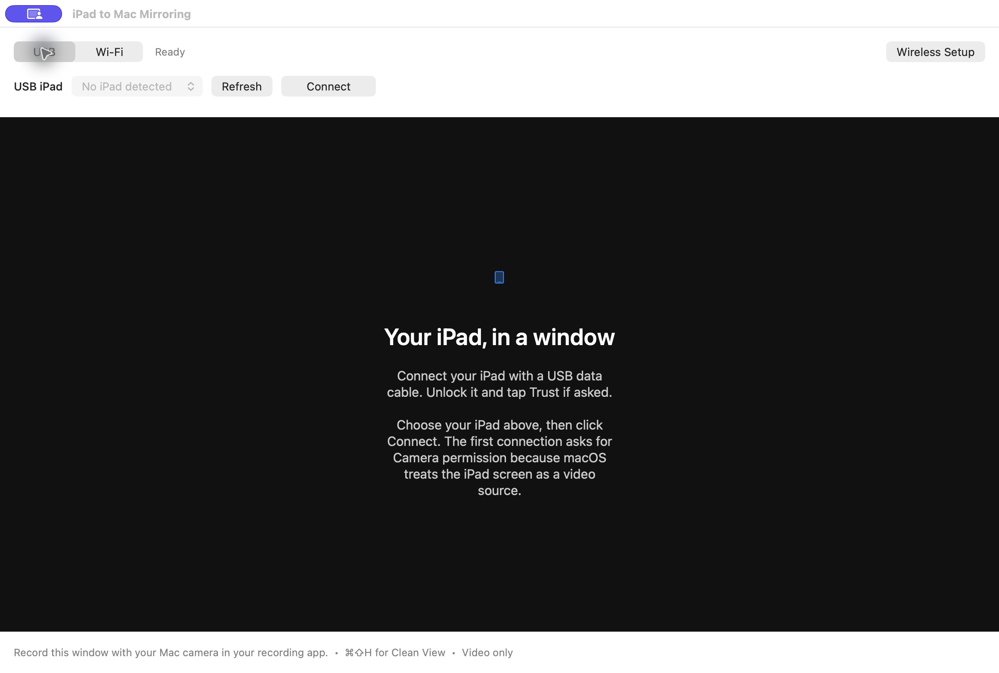
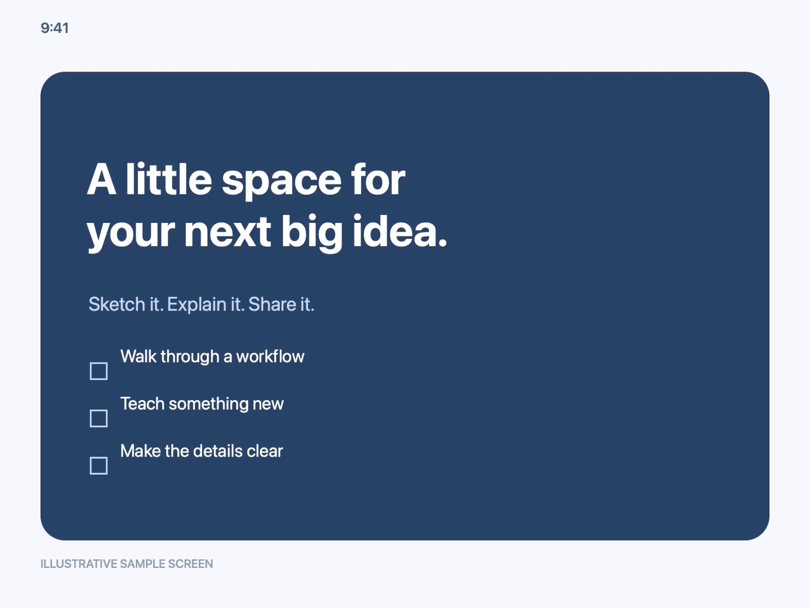

# iPad to Mac Mirroring

**Your iPad, in a Mac window. USB or Wi-Fi. Ready for Loom or OBS.**

A small native macOS viewer for presenting, teaching, and recording an iPad.
USB and wireless mirroring share one window. Wireless setup lives in a
collapsible sidebar, and Clean View hides the controls and title bar for capture.



*Documentation screenshots use generated sample content. They contain no personal
iPad screen, device identifiers, or live pairing codes.*

## What it does

- **One window:** switch between USB and Wi-Fi at the top.
- **Clean View:** press **⌘⇧H** to hide the sidebar, controls, and title bar.
- **Proportional resizing:** fit the window to the iPad image without stretching.
- **Capture-friendly:** select this window in Loom or OBS; let your recorder add
  the Mac camera bubble and microphone.
- **Local preview:** no account, analytics, cloud relay, or recording service.
- **Explicit wireless sessions:** start the receiver when needed and pair using
  the connection code in the sidebar.

This is a **video-only viewer**. It does not record, control the iPad, play iPad
audio, or open the Mac webcam/microphone. Use the iPad by touch and your recording
app for camera, narration, and saving/uploading recordings.

## Requirements

- An **Apple silicon Mac** running **macOS 14 or later**.
- An unlocked iPad and either a USB data cable or a shared trusted local network.
- Loom, OBS, or another Mac recorder if you want to record.

The current build targets arm64. An Intel Mac build is not provided or tested.
Protected video apps may prevent mirroring. Compatibility with every iPad/iPadOS
combination is not guaranteed.

## Mirror over USB

1. Open **iPad to Mac Mirroring** and select **USB**.
2. Connect a USB cable that supports data. Unlock the iPad and accept **Trust**
   if prompted.
3. Select the iPad, then click **Connect**.
4. Allow **Camera** permission when macOS asks. Apple exposes the wired iPad
   screen as a capture source; the viewer does not use the Mac webcam.
5. Resize the window or press **⌘0** to fit it to the incoming image.

The status bar reports the incoming resolution. The app requests the largest
selectable USB format; some iPads expose an automatically negotiated stream.
A larger window scales those pixels rather than adding detail.

<details>
<summary>See the USB setup screen</summary>



</details>

## Mirror over Wi-Fi

1. Put the Mac and iPad on the **same trusted network**.
2. Select **Wi-Fi**. The Wireless sidebar opens in the same window; **⌘2**
   also opens it.
3. Click **Start Wireless**. Allow **Local Network** access if macOS asks.
4. On the iPad, open **Control Center → Screen Mirroring** and select
   **iPad to Mac Mirroring** (or the receiver name you chose).
5. Enter the code shown in the Mac sidebar when the iPad asks.
6. The screen appears in the main viewer. **Hide Sidebar** gives it more space
   without ending the session.

Wireless requests **1920 × 1440 at up to 60 fps**. The iPad negotiates the actual
format, which can look sharper than the USB feed on some devices. The status bar
shows the negotiated video dimensions.

Click **Stop Wireless** when finished. Switching to USB, closing the main window,
or quitting the app also stops the receiver. Hiding the sidebar or using Clean
View keeps it running.

## Record with Loom or OBS

1. Start mirroring and make the iPad content ready.
2. Hide the sidebar, or press **⌘⇧H** for a video-only window.
3. In Loom, choose window capture and select **iPad to Mac Mirroring**. Enable
   your Mac camera bubble and select your microphone.
4. In OBS, add a macOS screen/window capture source and select this app's window;
   add your camera and audio sources separately.
5. Check the recorder's preview before starting a recording.



Press **⌘⇧H** again or right-click the preview to restore controls. In Clean
View, drag the image to move the window and use its edges to resize it. **View →
Always on Top** is available with either source.

| Shortcut | Action |
| --- | --- |
| **⌘⇧H** | Toggle Clean View |
| **⌘0** | Fit the window to the iPad |
| **⌘2** | Open Wireless Setup in the sidebar |
| **⌘1** | Show the main window |
| **⌘I** | Show stream information |

## Privacy and security

The app previews locally and does not intentionally save mirrored media,
connection codes, client keys, or raw receiver logs. USB mode opens only Apple's
iPad screen source and disables its audio ports. Your recorder's recording,
upload, and retention behavior is separate.

Wireless is intended for a **trusted local network**. Its four-digit code uses a
legacy AirPlay compatibility flow; it is not strong protection on a hostile LAN.
Bonjour exposes a local service endpoint, and the receiver runs as the logged-in
user rather than inside a security sandbox. Do not expose its ports to the
Internet. An upstream stalled-control-request denial-of-service limitation
remains documented in the review.

The app uses a private inherited socket to bring wireless video into the viewer;
it does not recapture the desktop or request Screen Recording access for this
purpose. Temporary per-session data is removed on normal stop. A crash may leave
cache/configuration files in the system temporary directory. macOS may remember
permissions and window placement.

Read [the privacy/security notes](SECURITY.md) and
[the focused code review and validation record](SECURITY-REVIEW.txt). The review
and tests are not a guarantee that all third-party vulnerabilities are absent.

## Troubleshooting

**USB iPad is missing:** unlock it, accept Trust, click Refresh, try a direct data
cable/port, and close QuickTime or other apps using its screen feed. Check
**System Settings → Privacy & Security → Camera** if access was denied.

**The wireless receiver is missing:** verify both devices share a network that
permits device-to-device traffic and Bonjour. Guest/office networks can isolate
clients even when the Wi-Fi name is the same. A personal hotspot is a useful
comparison. Apple's built-in Mac receiver may appear through peer-to-peer
discovery even when this local-network receiver is blocked. Check Local Network
permission, then stop/restart the receiver after changing networks.

**Connected but no video:** stop the receiver, disconnect Screen Mirroring on
the iPad, then reconnect. Keep the iPad unlocked and try unprotected content.

**The image has borders:** press **⌘0** to fit the window and hide the sidebar
or use Clean View. The viewer preserves the source aspect ratio.

**A downloaded build is blocked:** these local builds are ad-hoc signed, not
Developer ID-signed/notarized. Build from source if you want to inspect exactly
what you run. Notarized public binaries are a separate release step.

## Build from source

Requires Xcode Command Line Tools (or Xcode), Python 3, CMake, and Internet access
for pinned upstream downloads. The native build also uses the standard macOS
`curl`, `make`, `perl`, `pkgutil`, `patch`, and signing tools. Allow roughly **8 GB**
of working space for dependencies/build products.

```sh
./scripts/build-wireless.sh
./build.sh
open "build/iPad to Mac Mirroring.app"
```

The wireless build downloads and verifies version-pinned archives, extracts the
official GStreamer packages without running installers, and builds inside the
checkout. It does not require a globally installed Homebrew runtime or root.

To reuse an already built runtime:

```sh
./build.sh "/path/to/output" "/path/to/Wireless"
```

For a binary release, also generate the matching native corresponding-source
asset and attach it beside the app and this source release:

```sh
cd scripts/native
python3 collect_corresponding_source.py
```

Keep the generated `.tar.xz` and its checksum as release assets rather than
committing dependency archives into the Git repository. The collector verifies
pinned source archives and build recipes. A full Cerbero/SDK source rebuild has
not been verified; read `CORRESPONDING-SOURCE.txt` for the precise coverage.

The build uses local ad-hoc signing. See [native build details](scripts/native/NOTICE.txt)
and [licensing/release requirements](LICENSES.md) before distributing a binary.

## Tests and validation

```sh
python3 tests/run_wireless_tests.py
python3 tests/run_video_transport_tests.py
python3 tests/run_video_renderer_tests.py
python3 tests/run_native_boundary_tests.py --source scripts/native/sources/UxPlay-1.73.7
```

The renderer test needs macOS 14.4+ and access to the local codec service. It
briefly displays generated test pixels, without capturing a device or recording.
Additional native sanitizer and receiver smoke commands are documented in
[scripts/native/tests/README.txt](scripts/native/tests/README.txt).

Live testing confirmed USB preview, authenticated Wi-Fi video in the shared
window, Clean View, and Loom's window-and-camera preview. The review records
exact versions, automated checks, and limits. Rotation was not separately
verified, and no actual Loom recording/upload was performed during validation.

## How it works

The Swift/AppKit app uses AVFoundation/CoreMediaIO for Apple's USB screen source.
For wireless, an owned [UxPlay](https://github.com/FDH2/UxPlay) helper receives the
AirPlay stream and sends bounded H.264 access units over an inherited private
socket. Apple's video renderer displays them in the same native canvas. The
helper has no separate video window in the app's embedded mode.

```text
USB iPad → Apple capture source ───────────────┐
                                             ├→ one Mac viewer → Loom / OBS
Wi-Fi iPad → UxPlay → private H.264 channel ────┘
```

Start/Stop, per-run identifiers, bounded parsers/queues, and a parent/channel
watchdog control the receiver lifecycle. Receiver modifications and exact build
inputs are included under `scripts/native/`.

## License

**Original app code, documentation, and artwork: [MIT](LICENSE).** You may reuse
and modify those portions, including commercially, while keeping the notice.

The modified **UxPlay receiver/native integration is GPL-3.0-or-later**; its
other dependencies retain their own licenses. The complete bundled app is
**not MIT-only**. Preserve all applicable notices and provide corresponding
source/build materials when distributing binaries. See [LICENSES.md](LICENSES.md),
[the full GPL text](COPYING.GPL-3.0), and
[third-party notices](THIRD-PARTY-NOTICES.txt).

## Author and attribution

Created by [Russell Varriale](https://github.com/russellvarriale).
Original repository: [russellvarriale/ipad-to-mac-mirroring](https://github.com/russellvarriale/ipad-to-mac-mirroring).

Copies, forks, and distributions of original code or substantial portions must
retain the complete copyright and MIT permission notice, including the original
author/project reference. A credit and link in your fork's README are appreciated;
standard MIT does not require a visible credit inside every app using the code.
Preserve third-party notices too.

The app is an independent project and is not affiliated with Apple, Loom,
Atlassian, or OBS. iPad and Mac are Apple trademarks.
